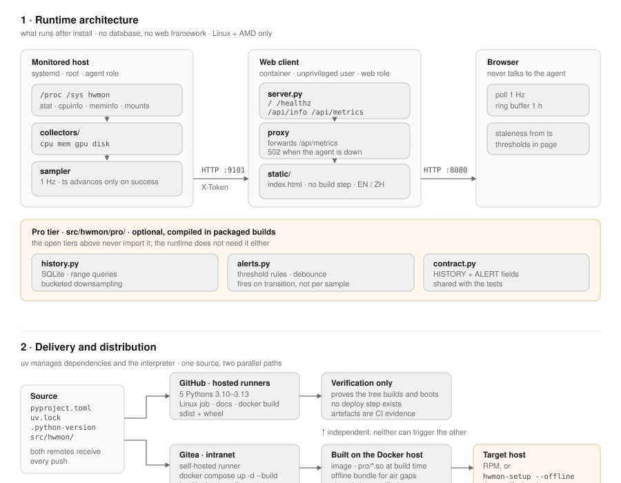

# hwmon — design and architecture

One diagram, two questions: what runs on the machine after install (§1), and how
the artefact gets there (§2). Both are drawn from the code in this repository,
not from an intended design — every box names a file or a command that exists.

## 1 · Runtime

Three processes, no shared state, no database in the runtime path.

### Agent — on the monitored host

`hwmon agent`, one process under systemd, started as root because reading hwmon
nodes takes privileges it cannot shed.

| Layer | Module | What it does |
|---|---|---|
| reading | `sysfs.py` | tolerant `/proc` and `/sys` readers; every helper returns `None` instead of raising, so a missing sensor costs one field rather than a sample |
| collecting | `collectors/{cpu,mem,gpu,disk}.py` | one module per subsystem, discovered at runtime through `importlib` |
| sampling | `sampler.py` | 1 Hz loop; **`ts` advances only when a sample succeeds**, which is how the dashboard tells "broken agent" from "unchanged values" |
| serving | `server.py` | `/api/metrics` (token-protected), `/healthz`, `/api/info` |

Disks refresh every 10th tick rather than every second, so spinning drives are
not woken once per second. A disk read failure keeps the previous list instead
of blanking the UI.

### Web client — a container, unprivileged

`hwmon web`, one process, no hardware access at all.

| Layer | Module | What it does |
|---|---|---|
| serving | `server.py` | the same handler class, different routes: `/` and `/favicon.svg` |
| proxying | `server.py` | forwards `/api/metrics` to the agent with the shared token; any upstream failure becomes a 502 with a stable message prefix the UI localises |
| UI | `static/index.html` | one file, no build step, EN + ZH, thresholds in the page, 1 h ring buffer in the browser |

The browser never talks to the agent. Port 9101 is expected to be firewalled to
the web host; 8080 is the only thing a user reaches.

### Pro tier — optional, and not in the runtime path

`src/hwmon/pro/` adds `history.py` (SQLite, range queries, bucketed
downsampling) and `alerts.py` (threshold rules that fire on a transition rather
than on every sample, with debounce and hysteresis). Both are compiled to native
extensions in packaged builds.

Three things about it are deliberate:

* **Nothing in the open tiers imports it.** The agent and the web client run
  unchanged whether or not the pro tier is present.
* **`contract.py` is shared.** The stored columns and the alert dict are defined
  there and asserted by tests, so a half-applied schema change fails instead of
  silently dropping a metric.
* **Compilation protects business logic, not a mechanism.** See
  [SECURITY.md](SECURITY.md#why-the-licence-verifier-is-not-compiled) for why the
  licence verifier is the one thing that stays source.

### Why there is no database and no framework

The dashboard is a few hundred lines of HTML/JS reading JSON once a second. A
framework would add a dependency tree to an agent that has to run on a bare
distribution host; the standard library covers it. The only runtime dependency
is `cryptography`, needed for signature verification.

## 2 · Delivery and distribution

`uv` owns dependencies and the interpreter everywhere: `pyproject.toml` +
`uv.lock` are the single source of truth, and every build path installs from the
lock with `--frozen`, so a stale lock fails loudly rather than resolving to
something nobody tested.

### Two remotes, two different jobs

| | GitHub | Gitea (intranet) |
|---|---|---|
| Runs on | hosted runners | self-hosted runner on the Docker host |
| Does | 5 Python versions (3.10–3.13), a Linux container job against a real `/proc` and `/sys`, docs check, `docker build` + boot smoke, sdist/wheel | `docker compose up -d --build`, health check, roll |
| Deploys | **never** | this is the only deployer |

Both remotes receive every push; neither can trigger the other's pipeline,
because each platform reads only its own workflow directory.

### Artefacts

| Artefact | Built by | For |
|---|---|---|
| wheel / sdist | `uv build` | library use, PyPI-style distribution |
| RPM | `packaging/hwmonpro.spec` | Rocky 8/9; `%build` compiles the pro extensions, `%install` only copies |
| container image | `Dockerfile`, `packaging/docker/Dockerfile.web-rocky{8,9}` | the web client |
| extension build image | `packaging/docker/Dockerfile.extbuild-rocky{8,9}` | produces `pro/*.so`, does not run the service |
| collector binary | `packaging/build_exe.py` (PyInstaller) | a diagnostic CLI for an arbitrary machine |
| air-gap bundle | `packaging/offline-bundle.sh` | interpreter + wheels + checksums for hosts with no network |

Rocky 8 and 9 ship Python 3.6 and 3.9 — below the floor — so the RPM and the
images provision a pinned interpreter rather than relying on the distribution's.

### Integrity

`packaging/sbom.sh` produces an SBOM (syft, SPDX and CycloneDX) over the built
image, a `SHA256SUMS` manifest, and an Ed25519 signature over each artefact
**including the manifest**. Verification (`hwmon verify`) fails closed on a
missing key, a wrong key type, a tampered file or a malformed signature.

The SBOM is scanned from the image rather than from `pyproject.toml` because the
question it answers is "what is in the box", and the box contains a CPython
runtime that uv installed.

### Constraints that shaped this

| Constraint | Consequence |
|---|---|
| Python 3.10 floor, 3.12 pinned | `requires-python >=3.10`; CI covers 3.10–3.13; containers and the RPM use 3.12 |
| Linux + AMD only | no compatibility layer for NVIDIA or other operating systems; the agent assumes `/proc`, `/sys`, systemd |
| Intranet deployment | no TLS, no login — the security model is the network boundary, documented in [SECURITY.md](SECURITY.md) |
| Air-gapped customers | `hwmon-setup --offline` installs from a checked bundle and never falls back to the network |

## Further reading

- [BUILD-COMPARISON.md](BUILD-COMPARISON.md) — measured PyInstaller vs Nuitka vs Cython data
- [docs/packaging-comparison.md](docs/packaging-comparison.md) — ABI and glibc behaviour of compiled artefacts
- [docs/offline-install.md](docs/offline-install.md) — the air-gap path end to end
- [AGENT.md](AGENT.md) — the working contract for changing this code
